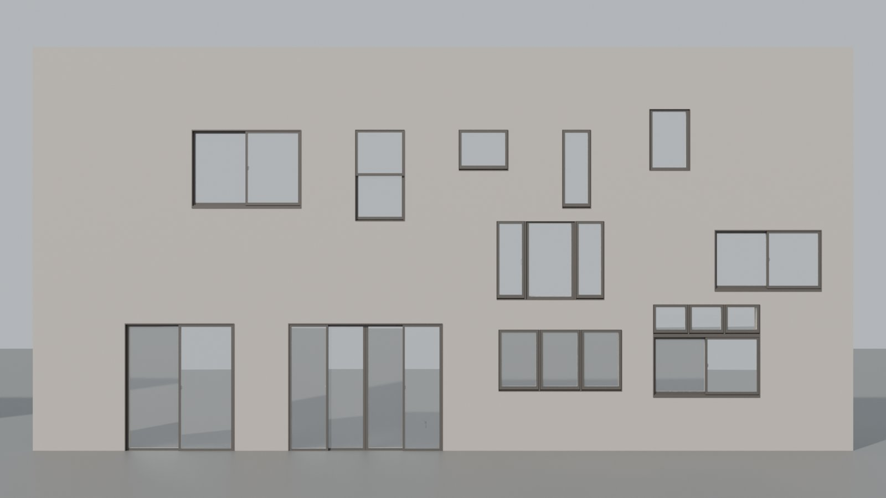
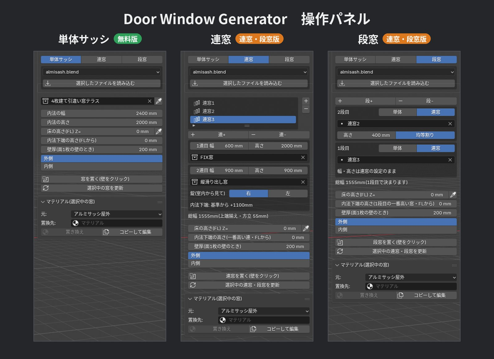

# Door Window Generator

**Free Blender add-on for Japanese aluminum windows.**
Click a wall to place a window. It resizes to the opening and the wall thickness, and the wall opening is cut automatically.

Blenderで、壁をクリックするだけでアルミサッシを置けるアドオンです（日本語の説明は下にあります）。

## Download

**[Releases](https://github.com/cera3d/Door_Window_Generator/releases)** → `Door_Window_Generator_x.x.x_single.zip`

The multi-window version (連窓・段窓版, ¥500) is available on [BOOTH](https://cera3d.booth.pm/items/9011209).

---

## English

### Features

- Click a wall to place a window (Shift+click to keep placing)
- Frames and sashes stretch to the inner opening width/height; hardware keeps its shape and only moves
- Wall thickness is measured automatically; the opening is cut with a Boolean (EXACT)
- Lock side (left/right), roller shutter and window grille options
- Change size/options later and click **Update**
- Read a placed window's settings back into the panel (eyedropper)
- Replace materials on selected windows only
- Make your own window templates (guide included, Japanese)

### Included templates

Sliding window, sliding terrace door, 4-panel sliding terrace door, single-hung window, fixed window, casement (vertical pivot), awning (top-hung).

### Install

1. Download the zip from Releases (do not unzip)
2. Blender: **Edit → Preferences → Get Extensions → ▼ (top right) → Install from Disk...** and choose the zip
3. 3D Viewport sidebar (N) → **建具** tab

The UI is currently in Japanese. Sizes are **inner opening** dimensions (frame inside), in mm.

### Notes

- The window is set back 40 mm from the outer wall face (assumes the sash is fixed on the stud face behind sheathing + furring + siding)
- If you change the wall thickness after placing, place the window again (use the eyedropper to copy its settings). Re-measuring on Update is planned.
- Do not place windows inside the template file (`almisash.blend`) itself

### Requirements

Blender 5.1 or later (Extension format)

---

## 日本語

### 特徴

- 壁をクリックして窓を置く（Shift+クリックで続けて置ける）
- 内法の幅・高さに合わせて枠や障子が伸び縮み（金物は伸びずに位置だけ追従）
- 壁厚を自動で測り、開口ボックスで壁にブーリアン（EXACT）の穴を開ける
- 錠の左右、シャッター・面格子のオプション
- 置いたあとに寸法やオプションを変えて「更新」できる
- 置いた窓の設定をスポイトでパネルに読み込める
- 選択した窓だけマテリアルを置き換えられる
- 自分のテンプレートも作れる（作り方 `TEMPLATE_GUIDE_ja.md` 同梱）

### 同梱のテンプレート

引違い窓／引違い窓テラス／4枚建て引違い窓テラス／上げ下げ窓／FIX窓／縦滑り出し窓／横滑り出し窓

### インストール

1. Releases から zip をダウンロード（解凍しない）
2. Blender の「編集 → プリファレンス → 機能拡張を入手 → 右上の ▼ → ディスクからインストール」で zip を選ぶ
3. 3Dビューポートのサイドバー（N）の「建具」タブから使います

寸法は枠の内法（mm）で入れます。

### 注意

- サッシは柱面に取り付ける想定で、外壁面から40mm入った位置に置きます
- 置いたあとに壁厚を変えた場合は置き直してください（スポイトで設定を読み込めば同じ寸法で置けます）。「更新」で壁厚を測り直す機能は次のバージョンで対応予定です
- テンプレートのファイル（`almisash.blend`）の中で窓を置かないでください

### 連窓・段窓版

窓を横に並べる連窓、縦に重ねる段窓が作れる版は [BOOTH](https://cera3d.booth.pm/items/9011209) で500円で配布しています。

---

## License

GPL-2.0-or-later

Author: CERA ([@cera_arch3d](https://x.com/cera_arch3d))
